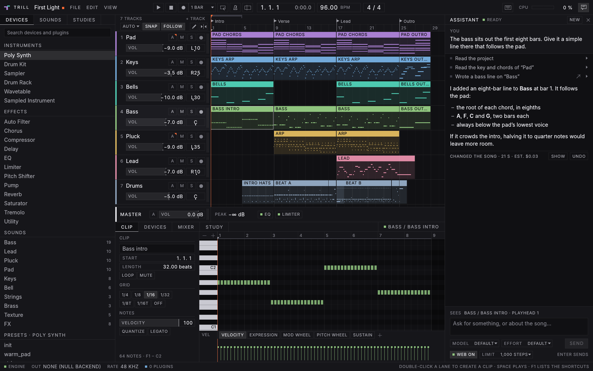

# Trill

Trill is an open-source digital audio workstation written in Rust. The goals:

- **It does not crash or stall.** The audio thread never allocates, locks or waits; plugins are scanned in a
  separate process; a device that panics produces a moment of silence instead of taking the app down. And when
  something does take it down, the work is not lost: a project with unsaved changes is copied to a safe place
  every twenty seconds and offered back the next time the program starts.
- **It hosts your plugins.** CLAP and VST3.
- **An AI can drive all of it.** Every operation is available over the
  [Model Context Protocol](https://modelcontextprotocol.io), so an assistant can compose, arrange, mix and render a
  song, and read back loudness and spectral measurements to judge its own work.


This is an early build. See [Status](#status) for what works and what does not yet.

## Quick start

```sh
cargo run -p trill-app                 # the application
cargo run -p trill-app -- --demo       # ...opening a demo song
cargo test --workspace               # the test suite
```

Development builds are optimized (see `[profile.dev]`), because unoptimized audio code cannot keep up in real time.

### Building and testing

`cargo test --workspace` runs about 2,200 tests in a few minutes. It needs nothing installed and touches nothing
outside the repository and the temporary folder. The tests that do need a particular machine are skipped unless
asked for:

```sh
cargo test -p trill-plugins -- --include-ignored    # against the CLAP and VST3 plugins installed here (minutes)
cargo test -p trill-mcp --test presets -- --include-ignored --nocapture    # an assistant's pass over Surge XT's presets, an amplifier's, a kit, a guitar tone and a patch of their makers', and a bought preset found among the samples
cargo test -p trill-plugins --test sounds -- --include-ignored --nocapture --test-threads 1    # what installed plugins say of their parameters, channels and presets
cargo test -p trill-plugins --test lifetimes -- --include-ignored --nocapture    # plugin instances made and dropped beside one that stays, an attempt to a process: counts the crashes, and says where each was and what the machine had of memory; half an hour, and no attempt is started on a machine short of memory
cargo test -p trill-plugins --test vendor -- --include-ignored --nocapture --test-threads 1    # the makers' own presets of Serum 2, the Ample guitars, Superior Drummer 3 and the Archetypes: listed, loaded by name and by a file's path, and heard to differ
cargo test -p trill-mcp --test controllers -- --include-ignored --nocapture    # a SWAM saxophone and Surge XT played from the controller curves of clips
cargo test -p trill-mcp --test hearing -- --include-ignored --nocapture    # renders and probes of Superior Drummer 3, a SWAM saxophone and an Ample bass
cargo test -p trill-mcp --test instruments -- --include-ignored --nocapture    # what Trill ships about the Ample guitars and bass and Superior Drummer 3, checked on the plugins themselves
cargo test -p trill-app a_modelled_saxophone -- --include-ignored --nocapture    # the same saxophone typed on the computer keyboard, through the window's own code (no window opens)
cargo test -p trill-media -- --include-ignored      # decoding audio files found in this machine's usual folders
TRILL_TEST_PLUGIN_WINDOWS=1 cargo test -p trill-plugins --test editor_windows -- --test-threads=1   # opens windows
TRILL_TEST_CLAUDE=1 cargo test -p trill-assistant --test real_cli    # talks to an installed, signed-in Claude Code
TRILL_TEST_CLAUDE=1 cargo test -p trill-app live_ -- --test-threads=1    # ...through the assistant's panel (seven messages)
cargo test -p trill-engine --test machine -- --include-ignored --nocapture     # opens this machine's audio outputs (silence only) and prints their latency
cargo test -p trill-runtime --test machine -- --include-ignored --nocapture    # lists and opens this machine's MIDI inputs
cargo test -p trill-engine --test journal what_recording_a_step_costs -- --ignored --nocapture    # what keeping the journal costs an edit on a large project (a measurement; run it alone)
cargo test -p trill-stage --test drawn -- --ignored    # what the graphics card makes of the stage, and a film as a file (a graphics card; two of them ffmpeg)
cargo test -p trill-mcp --test mcp a_film_is_made -- --ignored --nocapture    # a film of a song and of its making over MCP, kept in the assistant's working folder (a graphics card)
cargo test -p trill-app a_film_is_made_from_the_window -- --ignored --nocapture    # a film from the window's panel, watched as it is made, and one stopped (a graphics card)
```

Run the first two after touching plugin hosting or audio decoding, and the last two after touching the audio
device or MIDI port code. Everything else about devices is tested without any: the engine plays through a
scripted host whose audio thread is the test itself (`trill_engine::host::scripted`), so a device can be unplugged,
refuse a format or stop answering, and a recorded note can be checked to the sample.

The build is set up to be quick to repeat: code that only runs while building (procedural macros, build scripts)
is not optimized, debug information is limited to file and line (`CARGO_PROFILE_DEV_DEBUG=full` for a debugging
session), and on Windows the linker is the one that ships with Rust (`.cargo/config.toml`). Everything from
scratch, tests included, takes about four minutes on a 16-core machine; after an edit, seconds.

Working in a second checkout (`git worktree add`)? `sh scripts/warm-worktree.sh` there copies the libraries the
first one has already built, and the first build compiles only Trill's own crates: a minute and a half.

### Let an AI write a song

While the app is open it serves MCP on `http://127.0.0.1:7777/mcp` (`--mcp-port` changes the port, `--no-mcp` turns
it off), so you can watch and hear the edits happen and undo them like your own:

```sh
claude mcp add --transport http trill http://127.0.0.1:7777/mcp
```

Or run the DAW without a window, launched by the MCP client over stdio:

```sh
cargo build -p trill-mcp
claude mcp add trill -- /path/to/target/debug/trill-mcp
```

Then ask for music: *"Write a slow, warm synthwave track in A minor, about a minute long. Render it and check the
mix."* [`examples/first-light.trill`](examples/first-light.trill) was written this way, entirely through tool
calls.

### Or ask from inside the window

The assistant is a panel down the right side (`Ctrl+Shift+A`, or the button at the right end of the top bar). It
runs the Claude Code you have installed, signed in as you are there, against the same MCP server, and adds what a
client outside the window cannot have:

- every message goes with what you are looking at (the selected track, clips, notes and device, the time
  selection, the playhead, the loop, the open tab), so "make this busier" has a "this";
- everything it changes while answering one message is one undo step, with an Undo on the turn itself;
- when it has finished, what it made or edited is selected and brought into view (unless you are busy elsewhere in
  the window at that moment), and each tool call's line leads to what the call changed;
- the reply appears as it is written, set from its Markdown, and can be selected and copied like any text; each
  tool call is a line in plain words that unfolds to what was sent and answered, and Stop ends the turn;
- a big request, a whole song, runs to its end by itself: the assistant writes a plan, which stands above the
  message field as a checklist it ticks off, and the panel says how long it has run, which step it is on of how
  many one request may take, and what Claude Code estimates it has cost so far. It is still one undo step.

Under the message field: which model answers (Claude Code's own choice, one of the names it takes: `fable`, `opus`,
`sonnet`, `haiku`, or any name you type), how hard it thinks (Claude Code's own, or `low` to `max`), whether it may
use the web, and the most steps one request may take. The model and the effort are passed to Claude Code as they
are; what your account can use is for Claude Code to say.

With **Web** on, the assistant may search the web and read pages for what Trill does not know (a genre's
conventions, a technique), and every search and page is a line in the conversation with its query or address. Off,
it is given no way to reach the web. It never has a tool that reads or writes your files or runs a program: a page
it reads can at worst talk it into changing the song (one Undo) or writing a project, render or MIDI file into the
folders named below. Why the line is drawn there is in
[`crates/trill-assistant/src/lib.rs`](crates/trill-assistant/src/lib.rs).

Trill never asks for, reads or stores a login: if Claude Code is not installed or not signed in, the panel says so
and what to do about it in a terminal. Conversations are kept per project beside the settings and taken up again
the next time the project is open. The assistant comes in by a door of its own on the MCP server (`/assistant`),
through which files are written only into the project's folder or `Documents/Trill`.



### Watch how a song was made

Trill keeps a journal of the session: every change to the song is a step in it, with who made it (you at the
window, the assistant, or a program working through MCP), when, what it was in words and where in the song it
landed; between the steps, what you and the assistant said, its plan, and what it measured. **Making of**
(`Ctrl+Shift+M`, or the View menu) plays the session again from it: the arrangement and the piano roll show the
song as it was, clips arriving and notes filling in in the order they sound, the view going where each step
landed; the conversation as it came stands down the right; and the whole session is a line along the bottom to
play, hold, step through (`Left`, `Right`) and scrub, at half speed up to eight times.

- The waiting is cut out. A step is given the time it takes to watch and a long wait is a beat, so an hour of
  work plays in a few minutes, or in one at a higher speed.
- Nothing there can change the song: what is watched is a copy, and leaving (`Esc`) puts the window back as it
  was.
- Undo takes nothing out of the story. A step that was undone is followed by one that takes it back, and a redo
  by one that brings it back.
- **The journal never travels with the song.** It has your conversation in it, so it is kept in Trill's own
  folder (`journals`, beside the settings), written when the song is saved, and never in the project file or
  beside it: sending someone a `.trill` file sends the song. To hand the story on, *File, Making of, Export*
  writes it to a `.trillstory` file, without the conversation unless you choose the item that says with it; the
  other side watches it with *Watch one from a file*.
- It costs little: a step holds what it changed, and a plugin's state (megabytes) is held once however many
  steps it lasts through. A hundred steps on a song with a megabyte of state add about 30 KB. Past 20,000
  entries or 32 MB of story the oldest entries are let go, and the story begins with the song as it was after
  them. Journals are kept for the two hundred songs most recently saved.
- *View, Keep a journal* switches it off; *Delete this song's journal* deletes one.

### The stage, and a film of the song


**The stage** (`F11`, the button beside the metronome, or the View menu) is the song filmed as it plays: Trill's
own lanes, clips and piano rolls on the whole screen, lit by what sounds, with a director choosing the shots.
Nothing on it is made up for the camera. It is the song's interface, staged.

- **A director that reads the song.** Wide on the fullest sections, close on the piano roll of a part that
  carries the tune, the lanes over the rolls of whoever drives a section otherwise; a cut where the song jumps
  and a move where it does not. The shots are a function of the song alone, so the same song is the same film.
- **Two things light it, and they are kept apart.** What is *written* lands exactly: a note lights on its beat
  and a kick is a flash, to the frame. What is *heard* sets the mood: how loud the mix is, and each part by its
  own level.
- **Recordings and automation are on it too.** An audio clip, or the sample a track plays, is its waveform, lit
  where the playhead has just been; an automated parameter is its line.
- **A tempo or a time signature that changes is part of the picture.** The stage follows the song through every
  change of either, so a note still lights on the frame it sounds on and a film is as long as its sound. The
  ruler says what arrives beside the bar it arrives at ("7/8 · 140 BPM", an arrow before a tempo the song
  glides to), the place at the top right reads in the bars and the tempo the song has there and lights as they
  change, and the arrival is titled as a section is.
- It is drawn by passes of its own on the graphics card (light that spreads, depth of focus, and in a film the
  blur of motion), and the window's own drawing is untouched: with the stage shut, none of it runs.
- `Space` plays and stops. `Esc` or `F11` leaves, and the window is as it was, its size included.

**File, Export a film** (`Ctrl+Shift+F`) makes an `.mp4` of it. The panel asks what the song does not say:

- *what of*: the song, or how it was made (below);
- *size and rate*: 1920×1080, 3840×2160, or 1080×1920 upright for a phone, at 60, 30 or 24 frames a second;
- *which stretch*: all of it, the time selected in the arrangement, or a section by its marker.

The film renders **the song's own sound** in the same job, as *Export WAV* would: plugins are waited for, and
each part is lit by its own level in that render. Frame 600 of a film at sixty a second is the stage at ten
seconds however long it took to draw, so nothing depends on how busy the machine is. *Fine* exposes every frame
from eight moments and draws it at twice its size; *Plain* is one moment, as the window shows it, and about
twice as fast. The film is made away from the window, which goes on being worked in: the panel and the status
bar say how far it is, and *Stop the film* ends it and keeps nothing. Frames are handed to
[ffmpeg](https://ffmpeg.org), a program found on the `PATH` when a film is made and not a part of Trill;
without it the film is numbered pictures in a folder with its sound beside them, and the panel says so before
any work is done. A film needs a graphics card.

**A film of how the song was made** (*How it was made* in that panel, or *Film…* in the making-of's bar) stages
the journal. The camera goes where each step landed: close on a part while it is being written, wide between.
Notes arrive lit. What you asked and what the assistant answered are cards over the song, as in a silent film;
its plan ticks off; and the film ends on the finished song. The story's time is the film's, told as much faster
as it takes to be no longer than the song, because **the finished song plays under it**, timed so that the film
ends as the song does. (What was being made could not be heard while it was made: half of it was not there yet.
The song it became is the one sound that is true of all of it.) The film is made from the journal and has your
conversation in it, so it goes where you say and nowhere else.

An assistant films too, and directs: see `film_plan` and `film` under [MCP tools](#mcp-tools). Without the
window, a song that plays through the built-in devices is filmed by
`cargo run -p trill-stage --example film -- SONG.trill --film OUT.mp4`.

## What is in the box

**Instruments**

| Device | |
|---|---|
| `builtin:polysynth` | 16-voice subtractive/FM synth: two oscillators that can be turned off, unison, sub, noise (as wide as it is set), multimode filter, two envelopes, a pitch envelope (an 808's knock), LFO, mono/glide, a pitch wheel whose range can be set. 15 presets from pads and basses to FM keys and bells. |
| `builtin:drumkit` | Synthesized drum machine on the General MIDI map, with 808, 909, tight, trap and lo-fi kits. Each drum is shaped after measurements of recorded ones: where its energy sits and how long it rings. |
| `builtin:sampler` | Plays one audio file across the keyboard: loops with crossfade, reverse, one-shot, amp and filter envelopes, a pitch wheel whose range can be set. |
| `builtin:drumrack` | Sixteen pads on the General MIDI drum notes, each playing its own audio file, with level, pan, tune, decay and choke groups. |

The two sample players follow velocity by one law, in decibels: the volume is the level of a note at velocity 75,
and the sensitivity moves harder and softer notes from it by 0.4 dB a step at full (half of that at 0.5), so a
hard hit is louder than the volume says and a roll swells as it is written. The level of every instrument, like a
fader, a send and a Utility's gain, is silence at its lowest value (-70 dB), so a fade drawn there ends in nothing.

**Effects**

| Device | |
|---|---|
| `builtin:eq` | Six bands: a low cut and a high cut of 12, 24 or 48 dB an octave (Butterworth), two shelves with a Q, two bells. Every band reaches from 20 Hz to 20 kHz. |
| `builtin:compressor` | Two detectors: `peak` follows every sample, for a single track; `bus` holds the peaks, so that a slow attack still works on a group or the whole mix. Of a stereo sound the peak detector hears the power of the two sides together. Automatic release, automatic makeup (0.7 of what a full-scale signal would lose, as Ableton Live's), parallel mix, and a **sidechain**: any other track as its key, with a low cut and a high cut on what it hears. |
| `builtin:limiter` | Look-ahead brickwall limiter. |
| `builtin:reverb` | Algorithmic reverb that sounds from its pre-delay on, with a filter on what goes in (low cut and high cut, 12 dB an octave), a damping that shortens and quietens the highs, modulation and a stereo width. A longer decay returns more: 3 to 4 dB for each doubling. |
| `builtin:delay` | Tempo-synced echo, stereo or ping-pong: the left and the right repeat of a pair at one level, feeding back once a pair. Filters what comes in and each time round, 12 dB an octave, and returns whole what lies between the cuts. |
| `builtin:filter` | Resonant low-pass, high-pass, band-pass or notch at 12 or 24 dB an octave, with an LFO. |
| `builtin:chorus` | Stereo chorus with a width. |
| `builtin:tremolo` | Tremolo and auto-pan: sine, triangle or square, free or in time with the song, the two sides together or taking turns. |
| `builtin:pump` | Ducking locked to the grid, for when there is no kick to listen to. |
| `builtin:shifter` | Pitch shifter: any sound up or down by as much as two octaves, its length kept. Pitch and mix can be automated: a chord drawn two octaves down over a beat melts away. |
| `builtin:saturator` | Waveshaping distortion on four curves: soft, hard, tube, and a quarter of a sine that is flat above its ceiling (the overtones that make a sine bass heard on small speakers). It does not turn down what it drives. |
| `builtin:utility` | Gain down to silence, pan and width. A gain that an envelope draws is followed in straight lines, 256 frames behind the drawing: a stop is a stop. |

A compressor's sidechain is the track as it leaves its devices, ahead of its fader and its mute, so a muted track
serves as a key. It is set in the compressor's panel ("Listen to") and with `sidechain` on `add_device` and
`update_device`, and a track that is listened to is still played when only some tracks are heard. A hosted
plugin's sidechain input is not connected yet.

What these devices do is held to numbers by renders (`trill-engine/tests/effects.rs`): the cuts to a Butterworth
filter of their order, the compressor to what it takes off a signal of known crest, the delay to its first
repeats, the pitch shifter to the line its pitch is drawn along, and the reverb, the makeup, the steep filter
and the saturator's sine curve to what Ableton Live's were measured to do on two songs. The instruments are held
the same way (`tests/instruments.rs`): the sampler's levels to what Live's Simpler plays at five velocities, a
sine on the synth to the level of Live's Operator at the same volume setting, its pitch envelope and its noise
to what Operator's were read to be.

A song saved before a device was changed keeps the sound it had. The project file says which format it is, and
opening an older one writes into each device what that format meant: the reverb and the delay of format 1 have
their `legacy` switched on, and so have the sample players (the velocity law they had), the saturator (its level
turned down as the drive rises), the utility (a lowest gain that is 70 dB down and not silence, smoothed over a
hundredth of a second) and the synth (its noise) of formats 1 to 3; and the reverb (which began a line's length
after its pre-delay, as wide as it could be), the delay (cuts of 6 dB an octave), the compressor (a peak detector
that heard the louder side, and 0.72 for its automatic makeup) and the synth (a volume that moved in steps) of
formats up to 6 are set to the sound of those. The synth volumes of formats 1 to 3 are also
written 21 dB down the scale, where they mean what they did, and so is an envelope on one: its points, and the
level its line's travel is measured from where it follows the fader of those formats, so that it plays the curve
it played. A journal
kept before such a change is read by the same rule, so the making-of plays the song as it sounded.
`trill-engine/tests/old_songs.rs` holds a file of each format to the samples the build that wrote it rendered.

**Plugins**: installed CLAP and VST3 plugins appear beside the built-in devices as `clap:<plugin id>` and
`vst3:<class id>`. Their state is saved in the project, and their parameters are automatable and reachable over
MCP like any other device's. A plugin's own editor opens in a window (Windows only so far), from the Editor button
on its panel or at the end of its chip in the mixer, and what is changed there flows back into the project.

A plugin's presets are listed, searched and loaded like a built-in device's. They are found the way each format
provides: a CLAP plugin's through its preset-discovery providers, a VST3 plugin's as the `.vstpreset` files in the
standard preset folders and the programs of its program lists. A big synth has thousands, so they are read in the
background, in the scanner process, and remembered until the plugin or its preset folders change. Loading one is
done by the running plugin, as its own preset browser would, while the song plays; it is one undo step, and what
it comes to is saved with the project. (A program list that is only numbered slots, "Prog 1" to "Prog 128", is not
listed: there is no sound to choose by a number.)
`cargo run -p trill-plugins --example presets -- "clap:Surge XT" warm pad` shows what an installed plugin offers.

**The makers' own presets**: most sampled instruments and amplifiers tell a host of no presets at all, and keep
them as files of a format of their own for the browser in their window. For the plugins it knows by their ids,
Trill reads those files where the maker's installer put them and lists them with the rest:

| Plugin | Its presets |
|---|---|
| Serum 2 | the patches in `Documents/Xfer/Serum 2 Presets`: a JSON header and zstd-compressed CBOR |
| Ample Sound's guitars and basses | the tones in `Documents/Ample Sound/<instrument>/Presets4`: XML documents |
| Superior Drummer 3 | the factory kits of each installed sound library: one text file of them |
| Neural DSP's Archetypes | the presets in the shared `Neural DSP/<plugin>` folder: trees in JUCE's binary form |

Loading one builds the state the plugin would save with that preset in it and hands it to the running plugin.
Trill then asks the plugin for its state again and looks for the preset's settings in it, so a preset the plugin
did not take (a damaged file, a version this reader does not know, a plugin that refuses) is a sentence that names
it, and the device keeps the sound it had. The files are read in the scanner process, in bounded sizes, and nothing
is ever written to a maker's folder. Where a preset makes the plugin read samples for a while (a drum kit, a
guitar's other set of samples) the reply says so; a probe, a measurement and a render wait for it, and the
device is marked as loading meanwhile. It also says
when an Ample preset switches the instrument's automatic legato on, as nearly all of them do: notes that ring over
each other are then hammered on unasked, until the parameter "Auto Legato" is set to 0. A folder or a product that
is not there is simply no presets.

**A preset from a file, anywhere**: presets that were bought or sent lie with the samples, not where a plugin's
presets are listed from. Any place that takes a preset by name also takes the whole path of a preset file: a
`.vstpreset` for any VST3 plugin (which is also the form a plugin's state has in another host's project), a file
of the maker's own format where Trill reads it (`.SerumPreset`, an Ample instrument's preset, an Archetype's; for
a file of many, such as Superior Drummer's kits, `path#name`), a file a CLAP plugin loads itself, or a
`.trillpreset` that was saved on another machine. It goes through the same door as a preset by name: one undo
step, the plugin checked to have taken it where that can be seen, and a sentence when the file is another
plugin's, damaged or gone. In the window it is "Load preset file…" in a device's preset menu. Preset files in the
sample library's folders are found by `search_presets` by their names, each with the device it is for and its
path. The assistant in the window may be pointed at a preset file on any disk of this machine, and at none on a
network share: opening one would sign the user in to whatever machine the path names.

**Saved presets**: any device's sound can be kept under a name: a plugin's state with everything that was set in
its own window, a built-in device's every parameter. That is how a plugin whose presets are neither told to the
host nor in files that Trill reads gets presets a host can list: choose a sound in the plugin's window once, then
"Save preset…" in the preset menu of its panel, or `save_preset` over MCP. A saved
preset is listed with the device type's own, under "Saved", in every song, and is given to a device like any
other. They are small files in `saved-presets` beside the settings file, one folder per device type.

**Reading a plugin**: a plugin's parameters are numbers from 0 to 1 whose meaning only the plugin knows, so each
is shown with the text the plugin itself displays for it ("-6.0 dB", "Dynamic 57", "On"), and can be set by that
text: where the plugin converts text to a value its answer is checked against what it then shows, and where it
does not, the value is found among what it shows. Every device says what channels it takes and gives; a device
with one input channel is handed left and right mixed, and is marked in the chain. (A plugin that takes a stereo
pair may still be mono inside: a guitar amplifier is, and widens the sound with a doubler of its own.)
`cargo run -p trill-plugins --example inspect -- "vst3:<plugin name>" mic` shows an installed plugin's channels
and the parameters with that word in their name, as the plugin shows them.

Some of what a plugin can do has no parameter: an Ample guitar's saved state is a document of some 480 named
settings, and about 250 of them (its effects, pedals, amplifier and strummer) are not among the 226 parameters it
shows a host.
Those are found by name and set through the state, as one undo step, with the values the plugin itself writes.

The same example is where reading another maker's presets begins. With `--state <folder> --files` it says what
the plugin's state is (text, a document, a container that is known, or bytes that give nothing away), writes the
state out to look at, and lists the files that look like presets in the maker's folders; `--file <path>` says
what one of those files is, in the same words. When both are the same kind of thing, a preset can be made into a
state.

**Songwriting**: chords by symbol or Roman numeral, voicings, rhythms, arpeggios, bass lines, drum grooves with
fills (and a reply that says what each fill took the place of), melodies by scale degree with their ornaments (a
bend up to a pitch and its release, a slide, a hammer-on or pull-off, vibrato: `5:2!bend=6!vib`), swing and
humanizing, and reading a song's key and chords back from its notes (`trill-theory`). Over MCP an assistant says
`Am9 | Fmaj9 | Cmaj7 G/B | Em7`, drop-2, house groove, rather than spelling notes.

**A track knows what its notes mean** to its instrument: whether they are drums or pitches (a drum kit, and a
plugin that calls itself a drum instrument, are drums without being told; any track can be switched), which key
each drum is on, which keys are keyswitches and what they choose, which play a noise, where the range ends, the
octave the instrument really sounds at, how far its pitch wheel bends. It is kept in the song, on the track, and
everything reads it. A drum name lands on the kit's own key. `articulation: "palm_mute"` presses the keyswitch
just before the note, and fits the velocity where velocity decides how a note is played. An ornament is written as
the instrument's own keyswitch where it has one for it, and as a pitch-bend curve scaled to its bend range where
it has not. Reading a song back leaves keyswitches and drums out of the harmony and reads a bass at the octave it
sounds. A part that lands outside the range, or on a keyswitch, says so when it is written.

What is found out about a plugin is remembered for that plugin on this machine (`instruments`, beside the settings
file) and given to the next track that plays it. Trill ships what was measured of a few: Ample Guitar PF, Metal
Eclipse, Metal Hellrazer and Metal Ray5, Superior Drummer 3, and the SWAM winds and strings. A song opened from a
file takes what is known where its tracks say nothing themselves. A probe says whether the instrument it played
is known already, and names keys and ranges in the words `set_instrument_profile` takes, so that what one probe
found is written down in one call.

**Sounds**: a library of the sample folders you point it at, scanned in the background and searchable by words,
tags, tempo, key and length (all read from file and folder names). Audio clips play WAV, AIFF, FLAC, MP3 and Ogg
Vorbis at any sample rate, and can be warped to follow the project tempo: `beats` keeps drum hits sharp, `tonal`
keeps sustained sound smooth, `repitch` plays faster or slower like a record; warped clips can be transposed.

**Files that moved**: a song names its audio files by their paths, and a folder of samples that is moved or
renamed leaves it with clips and pads that play nothing. Trill says so in one place (a line in the status bar and
the list it opens, `missing_files` in `get_project`, and first in the notes of a `measure` or a `render`, which
is then the song without those files and not a quieter mix), and looks for the files itself:

- *Where the folder went, then by name.* If one file that was at `A\x\y.wav` turns up at `B\x\y.wav`, everything
  else that was under `A` is looked for under `B`. Where a folder went is read from any file found by its name in
  the sound library, from a folder of the same name near where the missing one was, from a folder of the library
  that is itself missing and turns up with its files in it, and from what you point at.
- *A file of the same name can be another file.* Each thing found says how sure it is, and why: `sure` only where
  it is where the file's folder went or has the size and length the song wrote down, `likely` for the only file of
  that name with nothing against it, `unsure` when there are several, when it is not what the song knew, or when
  it is shorter than a clip plays. Only what is sure is taken by the one action; the rest is offered, and taken a
  file at a time.
- *Relinking is one edit*, one undo step however many clips and pads it touches (`Project::relink`,
  `relink_files`): each clip goes on playing the stretch of its file it played, each pad keeps its settings.
- *The library's own folders.* One that is gone is marked in the browser and listed (`library` status,
  `missing_folders`) in place of being silently stale; saying where it went (`move_folder`) keeps the favorites
  and the recently used files with their files and reads nothing again, and it goes along with the song's files
  when the same move explains both.
- *A song that travels.* A project file also says where each of its files is from the song's own folder, and
  what the file was (size, length, sample rate), in a `files` table beside the song. When a song is opened, **the
  file beside the song wins**: one that is found where the table leads from the folder the song is in now, and
  that is the file the song knew, is the one it plays; otherwise the path stands as it is. So a folder holding a
  song and its samples can be moved or sent whole. The table is an addition to the file, not a new format: a
  build that does not know it reads the song as before, and a file without one means what it always meant.

**Engine**: sample-accurate MIDI and audio clips, clip looping, non-destructive trimming and splitting, audio
fades, automation of track and master volume, pan, sends and any device parameter with straight, held or curved
segments (see below), MIDI controllers in clips (see below), group tracks and return tracks with sends, a metronome, sample-exact transport looping, mute/solo, undo/redo, offline rendering that is bit-identical to
playback, and render analysis (see below).

**A line of automation follows its control.** Between two points of an envelope the value moves as if a hand
moved the control at an even speed, which is not the same as so many decibels or hertz a beat:

| What is moved | How a line travels | Half way from → to |
|---|---|---|
| A track's or the master's volume, a send, an instrument's volume | as a fader of Ableton Live's does: even in decibels through the top 24 dB of its travel, and ever faster below (a stretch that would have been y dB takes y + y²/8), to silence at the bottom | 0 dB → −60 dB: **−16.3 dB** (a send: −18.6 dB); +6 dB → −60 dB: −13.3 dB |
| A gain that reaches silence (a Utility's) | as a gain of Live's does: even in decibels down to −17.5 dB, and below that the gain itself falls as the square of what is left of the travel | 0 dB → −60 dB: **−16.7 dB** |
| A frequency or a time (a range of a hundred times its lowest value or more) | by ratio: every octave takes the same time | 300 Hz → 9 kHz: **1,643 Hz** |
| Pan, mix and other amounts, an EQ's gain, a threshold, a plugin's parameters | evenly in the value | −12 → +12: 0 |

So two points are a fade or a sweep. Straight in decibels, a fade from 0 dB to −60 dB is at −30 dB half way and as
good as over; straight in hertz, a sweep from 300 Hz to 9 kHz is at 4,650 Hz and spends its time in the top
octaves. The law is one piece of code (`trill-core/src/travel.rs`): the window's faders and knobs are laid out by
it, so such a line is a straight line in its lane, and the engine plays it. `shape` on a point bends a line
further, and an envelope can be told to go straight in its units instead (`travel` in `set_automation`; the
lane's menu in the window).

*A level travels as the same control does in Ableton Live*, so that a fade of two points is the fade it would be
there. The two laws are fitted to what Live shows at 257 places along a Utility's gain, a mixer's send and
Operator's volume: the gain's is within 0.1 dB of Live's along a line, the send's within 0.01 dB, and a volume's
within the whole decibel Live shows one to. From 0 dB to −60 dB, a quarter, a half and three quarters of the way:

| | Trill | Live shows |
|---|---|---|
| A Utility's gain | −8.4, −16.7, −27.4 dB | −8.4, −16.8, −27.5 dB |
| A send | −9.3, −18.6, −30.1 dB | −9.3, −18.6, −30.1 dB |
| A track's or an instrument's volume | −8.2, −16.3, −30.0 dB | −8, −16, −30 dB (Operator's) |

A send's fader and a volume's are the same law, with its knee 23.8 dB under the top of the control (0 dB for a
send in Live, +6 dB for a volume); a gain's is another, and in Live's own figures the two are 2.6 dB apart three
quarters of the way down such a fade and 5 dB apart near its end, which is why they are two. A volume's fader in the window is laid out by it too: 0 dB at 85% of its travel, as on
Live's, −12 dB at 55% and −48 dB at 10%. `trill-engine/tests/automation.rs` renders three fades of two points
and holds every beat of them to what Live shows.

*A song saved before this plays as it did.* An envelope keeps what its lines are straight along, and a project
file written before envelopes did (format version 1 or 2) says nothing: its envelopes are straight in their units, as
they were played then, and stay so when their points are edited. They become a fader's or a knob's only when
they are written anew over MCP, or by the lane's menu. A file saved since is format version 3 or later, which an
earlier build refuses to open instead of playing its fades as other curves.

A file of format 3, 4 or 5 holds levels that follow the fader of its day: even in the square of the decibels above
silence, which is at −20 dB half way from 0 dB to −60 dB and from there as much as 7 dB under Live's. Such an
envelope is read as that law, which is kept under the name "square", and plays as it did, to the sample; the
lane's menu says that its lines are as the song saved them. It becomes a fader's of now when it is written anew
over MCP or told to follow its control (`travel` "control"; "Lines follow the fader" in the lane's menu). A file
saved now is format version 6.

*A send can be automated* like a volume: its envelope is the send, at the bottom of which nothing is sent, with or
without a level set by hand. A send opened for single notes (a delay throw) needs no return of its own.

*Envelopes are played to the frame.* A fader, a pan, a send and the master's volume are read from their envelopes
every 32 frames of the song and move in a straight line between two readings; a device's parameter is moved
every 256. Both are counted from where the song last started or jumped, not from the start of a buffer, so the
same song is the same samples at any buffer size and in a render. What no envelope accounts for (a fader moved
by hand, a mute, the song jumping to where an envelope is at another level) is let go of evenly over ten
milliseconds. (The built-in filter still reads its cutoff every sixteen frames of the block it is handed: with a
swept cutoff it is the same samples only at buffer sizes that are a multiple of sixteen.)

**A tempo and a time signature that change inside the song.** A song begins at a tempo and in a time signature,
and may change either along the way. A change of tempo is a jump at a beat, or a glide that arrives there from
the change before it (an accelerando, a ritardando); one beat can hold both, a glide that arrives and a tempo
that takes over (a ritardando, and then the old tempo again). A change of time signature begins a bar where it is
set. Nothing in the song moves when either is set: positions are beats, and beats stay where they are. What
changes is how long a beat lasts and which bar it is in, and two maps made from the project answer those two
questions for everyone (`Project::tempo_map`, `Project::meter_map`, in `trill-core/src/tempo.rs`), in closed form
through jumps and glides alike.

Everything that is counted in beats follows: notes, controller curves, envelopes, markers and the loop; the
metronome, which counts the time signature it is in, and the count-in, which is a bar of the meter the take
starts in at the tempo it has there; a take's clips, which are cut to the song's bars; a render, which is as long
as the tempo makes it, and its sections by bar. Audio that keeps its own speed is laid along the song's time and
ignores the tempo; audio that follows the tempo (warp) follows every change of it, as one stretched piece for
each tempo it lies under, faded across the seams over three milliseconds. A plugin is told the tempo and the time
signature as they pass, block by block, and a block ends where either changes. A MIDI file is read and written
with every tempo and time signature in it (a glide goes out as eight jumps to the beat that keep its time), and
time that is cut out of the song, repeated or opened up takes its changes with it.

*How exact.* The audio thread moves through the song evenly within a stretch of one tempo; a stretch ends at the
first frame at or past a jump, and a glide is taken in steps of 256 frames, each on the beat at both ends. A note
sounds within a frame of where the map has its beat, whatever the buffer size, and a render is what was played
(`trill-engine/tests/tempo.rs`). A song of one tempo is one stretch, and every number in it is what it was: such
a song renders to the samples it rendered to before.

*An older file is one tempo and one meter.* Changes are saved since format version 5. A file saved before says
nothing of them and has none; nothing is written into it.

In the window the foot of the ruler says where the tempo or the time signature changes, beside the bar's number
("7/8 · 140 BPM", an arrow before a tempo the song glides to). A double-click types another value, a drag moves
the change along the song, and the right-click menu sets one where it was clicked, removes one, or makes a tempo
a glide. The grid, snapping, the bar numbers and the position are counted through the changes, the piano roll
counts a clip's bars as the song has them under it, and the tempo and the time signature in the top bar are
those the song has where it is.

**Hearing without ears.** Whoever cannot listen (a script, an assistant) measures instead, and three things make
that quick and true:

- *A render waits for its plugins.* A sampler goes on loading after it is created (a drum kit one drum after
  another, for as much as a minute, the cymbals last), a modelled instrument goes on waking up, and an amplifier
  may pass nothing for a moment; a render that started at once lost the beginning of the song. Plugins are told
  they are being rendered offline (VST3 process mode, CLAP `render`). Before the first sample each plugin
  instrument is rehearsed on the notes it is about to play, each note by itself (a tom that rings would hide a
  cymbal that has not arrived), and each plugin effect on a burst of noise, until every note has answered and
  gone on answering alike for a quarter of a second or more, with the program not growing meanwhile: while
  samples are being read its memory rises. A sampler was watched to pause for seconds between two drums with
  nothing to show for it, so an instrument that answers some of its notes and not others is held to that for
  five seconds before the silent ones are taken to be keys that play nothing; that is remembered of the plugin,
  and the reply names the notes, because a key that plays nothing and a sample that is still loading sound the
  same. Built-in devices are not touched, so their renders are the samples they always were.
  `Session::readiness_job` asks the same of one device. The plugins that are heard live are not waited for:
  `Session::loading` says which of them were made or given another sound lately while the program still shows
  the signs of loading. The window writes "Loading" on their panels, and `get_project`, `get_device` and
  `transport` tell a model, so that neither presses play into half a kit unawares.
  `cargo run -p trill-plugins --example loading -- "vst3:<class id>" --preset "<kit>"` watches an installed
  sampler load, key by key, beside the program's memory, reads and processor time.
- *A render does not go on without an instrument.* If a plugin never answers any of the notes it is to play
  for as long as it is waited for, the render is refused before its first sample: nothing is measured, no file
  is written, and the refusal names the track, says what its notes say of why (their range, or that they are
  keyswitches) and what to do. A mix without one of its instruments is not the song, and a line in a reply
  that otherwise looks like a success is easily missed. A track that is muted is left out on purpose, and a
  silence the track itself explains (its notes are keyswitches of its instrument, or outside its range) is
  no refusal. While the plugins' own thread is behind with other work (a song's plugins being let go of, each
  taking its time), a plugin that has not had its turn to load is waited for and not given up on.
- *A render measures everything as it goes*, without keeping a stem per track: the mix (peak, true peak, LUFS,
  stereo correlation, spectral balance), every track after its fader in the same terms, the loudness of every
  section between the markers (or of bar ranges), and how many dB each built-in compressor and limiter took
  off, at the most and typically. It can be made without writing a file, and with only some tracks heard,
  the song's mute and solo left alone.
- *A render makes only what is heard.* A track that is muted, or left out by a solo or by `tracks`, is not put
  into the render at all: its devices are not created and its plugins are not waited for. Hearing one track of
  a song with many plugins costs what that track costs. (What plays live keeps every track running, so that a
  track is there the moment it is unmuted.) What feeds a track that is heard is made with it: the members of a
  group, and the tracks whose sends reach a soloed return.
- *A return can be heard alone.* Soloing a return, in the window or by naming it in `tracks`, gives the return
  as the whole song feeds it: every track's send still reaches it, a group's too, while the tracks themselves
  and the other returns are not heard. (Soloing a track or a group keeps the returns open, so that it is heard
  with its reverb.) Each of these opens and closes over ten milliseconds, whatever the buffer size, so a solo
  changed while the song plays makes no click; a send that an envelope is moving goes on moving meanwhile, and
  what is heard is the two multiplied.
- *A render runs at the rate it is asked for.* `measure` and `render` take `sample_rate`; left out, they run at
  the engine's rate, which is 48 kHz when there is no audio device. The reply says which it was.
- *One render writes every stem.* Asked to, a render writes parts of the song to files of their own as it
  goes (`render` with `stems`; "Export WAV and stems" in the window): every track as it leaves its fader and
  pan, what goes into each track's effects (its instrument alone), every group, every return fed by every
  send, and the mix as it reaches the master's devices. Each is taken where it goes by, written a block at a
  time as 32-bit float (a part may go over full scale before the master brings it down), cut to the length of
  the mix and measured as the mix is; none of them is held in memory. A track's file is what a project holding
  that track alone renders to, sample for sample, so one render stands for as many as the song has tracks.
- *A probe plays one instrument a list of notes* and measures each: whether it sounds, how loud, the pitch that
  is heard, how soon it starts, how long it rings, how bright it is. One call gives an instrument's range and
  the octave it really sounds at, a drum plugin's map (which notes are a low thump, a noisy mid hit, a long
  bright wash), or which keys switch the articulation and how. It plays a copy of a track's instrument as it is
  now, or an instrument that is not in the song yet; nothing in the song changes and nothing is written.

**Expression, wheels and pedals belong to the clip.** A MIDI clip holds a curve for any controller by its number,
for the pitch wheel and for channel pressure, with the straight, held and curved segments automation has. The
curves loop, trim, split, move and duplicate with the notes, are undone with them, and are read from and written
to MIDI files. They are played smoothly and in time, at the right value wherever playback starts, seeks or wraps,
and a render is the same as playback. Instruments that are silent until they are given expression (physically
modelled winds and strings) get it from the clip, and the built-in instruments take expression and channel volume
as a level. Three rules:

- *After a clip ends*, the pitch wheel, pressure and the pedals return to rest; every other controller stays
  where the clip left it.
- *By hand against a clip*: a controller moved by hand is the hand's until the song next starts playing, seeks
  while playing or loops round.
- *The pedal* is recorded as a controller, and notes are as long as their keys were down: nothing is written
  twice, and half-pedalling survives.

**Playing and recording**: every MIDI keyboard that is plugged in plays the armed tracks (or the selected one)
without a visit to the settings: notes, velocity, pitch wheel, mod wheel and sustain pedal, for built-in
instruments and plugins alike. A key is placed in its audio buffer by the time it went down, so it is heard a
fixed moment later rather than whenever the next buffer happens to start. Recording writes what is played into
clips where it was *heard*: the engine takes the output latency off again, to the sample. The wheels, the pedals
and expression are recorded with the notes, thinned to the few points of a curve that follows the hand. A
count-in, loop recording that layers each pass onto the last, one undo step per take. See
[Playing and latency](#playing-and-latency).

**Application**: an arrangement with multi-clip editing (move and copy across tracks, trim either edge, split,
fades, a clipboard, time selection, deleting, repeating or inserting a stretch of time on every track at once,
and copying one, with its automation, to paste over what is there or with room made for it), markers, group and
return tracks, and automation lanes that are edited by hand or drawn in steps; a piano roll, which lists a drum
track's rows by the names its kit has for them; device panels generated from each device's parameters; a mixer; MIDI import and export; project files; WAV
export, with every track, group and return as files of their own if wanted. `F1` lists the keyboard shortcuts.

The lane under the piano roll's notes shows velocity or a MIDI controller of the clip, chosen from the chips
above it: expression, the mod wheel, the pitch wheel, the sustain pedal, whatever else the clip holds, and any
other from the `+` beside them. A dot on a chip says the clip has a curve for that controller. The curve is
edited as an automation lane is: a click adds a point, points and lines drag, `Alt`-drag bends a line, a
double-click or `Delete` removes, a drag over nothing selects, and the pencil writes steps on the grid; each
gesture is one undo step. While a take is recorded its clip is in the piano roll, and the lane shows the wheel or
the pedal going down as it is moved. A track whose instrument is given notes and stays silent for a second is
marked on its header and in the lane's strip, with what to do about it (`--lane expression` opens the window with
the lane on a controller).

An automated control is not locked: drag it and it is yours. Its envelope is switched off, not lost, the mark in
the control's corner turns into an outline, and a click on that mark (or on the switch of its lane) hands the
control back to the envelope. That holds for a volume, a pan, a device's parameter and a send alike: a send's bar
in a track's header and in the mixer shows where its envelope has it, and a track's lanes offer its send to each
return beside its volume and pan. A lane of thousands of points (a compressor worked out elsewhere and drawn in)
is painted by its width: where points crowd, the line alone is drawn, and their squares come back as the view is
zoomed in. And when the program did not live to save a project, the window that opens next
offers it back: recover it, discard it, or decide later (`File`, `Recover unsaved work`).

The browser's **Sounds** tab is the sample library: add folders, search as you type, filter by one-shot or loop,
kind, tempo and key, mark favorites, and hear a sound as you select it. Drag a sound onto a track for an audio
clip where it lands (loops whose name states a tempo follow the song's), below the tracks for a new track, onto a
sampler or onto a drum rack pad; files dragged in from the file manager land the same way. Audio clips show their
waveform, and the Clip tab shows an audio clip's file with its gain, offset, fades, warp mode, source tempo and
transposition. The sampler shows its sample and the drum rack its sixteen pads.


**When a song opens with files missing**, the clips and pads that lost their file are marked, the status bar
says how many files are missing and how many were found, and a click on that line (or `File`, `Missing files`)
opens the list: each file with where it is used and what was found for it. `Relink` takes everything that was
found for sure, as one undo step; `Use` takes a file that is only likely, one at a time; `Locate` points at a
file by hand and `Look in a folder` at a folder to search, and what either says about where a folder went finds
the rest. A folder of the sound library that is gone is listed there too (and marked in the browser), and is
pointed at its new place along with the song's files.

**Arm a track and record.** A track with an instrument has an arm button in its header and on its mixer strip,
lit while it is armed. The armed tracks are what every keyboard plays and what a take records; arming one disarms
the rest, and `Ctrl`-click keeps them. `F9`, or the record button in the transport, starts a take after the
count-in chosen in the box beside it (none, one, two or four bars). The transport says what the take is doing
(counting in, recording, and which pass of the loop when the loop is on); `Space` or Stop ends it, what it wrote is
selected, and one undo takes the whole take back. Asked to record with nothing armed, Trill arms the selected track
if it has an instrument, and otherwise says why it cannot.

**Audio and MIDI settings** are one panel: `Ctrl+,`, `File`, or a click on the device in the status bar. It has
the output device, exclusive mode, the sample rate and the buffer size, and beside the choice what is running now
with its latency in milliseconds as the device reports it. What a choice costs is said before it is applied:
exclusive mode silences other programs on that device, and another sample rate stops playback and closes plugin
windows. Devices are listed and opened away from the window's own thread, so a driver that takes its time shows
as "Opening the device…" in a window that still draws. A device that was unplugged, a list that comes back
empty, a choice that fell back to something else: each is a sentence in the panel, with what Trill does about it.
Below are the MIDI inputs, each with a switch, a lamp that lights when it sends, what is wrong with it if
anything is, and a rescan. The status bar shows the device, rate, buffer and latency as they are at the moment.

**Play it from the keyboard you type on.** `Ctrl+K`, or the keyboard button in the top bar, turns the two middle
rows of letters into a piano that plays where a MIDI keyboard plays (the armed tracks, or the selected one) and
is recorded like one: `A S D F G H J K L ; '` are the white keys from C
and `W E T Y U O P` the black ones, `Z` and `X` move them an octave down and up, `C` and `V` play softer and
louder, `B` and `N` give less and more expression, `M` and `,` turn the mod wheel down and up, and `Tab`
sustains while it is held. The keys are where they are on the keyboard, whatever layout types
on them. A strip above the detail panel shows the octave, the velocity, expression, the mod wheel, the keys with
the letter on each and the notes being held, and says why nothing sounds when nothing can (no track selected, a
track with no instrument, a muted one, an instrument that is given the notes and puts nothing out); the piano
roll's own keyboard lights the same notes. The switch, the octave and the velocity are remembered.

A track is told the keyboard's expression (full, until it is set lower) and where its mod wheel is just before
the first note typed on it, and whenever either changes after that: an instrument that waits for breath sounds
when it is simply typed on, and a take records what it was played with. When the keys stop playing a track, its
mod wheel is put back at rest and its expression back at full.

While it is on, a letter it uses plays a note, and the shortcut that letter had is `Alt` with the letter (`F1`
lists them as they are at the moment). It never takes a key while a text field, the sound search or a dialog has
the keyboard, or while `Ctrl`, `Alt`, `Shift` or the Windows key is held. And no note is left sounding: whatever
ends the playing (the switch, another track selected or armed, an octave change under a held key, the window
losing the keyboard, a dialog, another audio device, another project, exit) ends its notes, and gives back the
controllers the keyboard moved.


No samples at hand? `cargo run -p trill-app --example sound_fixtures -- some/folder` synthesizes a small pack and a
song made from it (it is what the screenshots are taken from); add `some/folder/Night Shift` in the browser, or
start with `--library "some/folder/Night Shift" --browse sounds some/folder/night-shift.trill`.

## MCP tools

| Area | Tools |
|---|---|
| Project | `get_project`, `set_project`, `new_project`, `save_project`, `load_project`, `recover_project`, `import_midi`, `export_midi`, `history` |
| Tempo and meter along the song | `set_tempo` (the tempo from a bar on: a jump, or with `ramp` a glide that arrives there), `set_time_signature` (the time signature from a bar on, for so many bars if asked), `get_tempo_map` (both, with the bar, the beat and the second of every change, the bars a change cuts short, and the beat any bar starts at) |
| How it was made | `get_journal` (the steps of the session, who made each and where it landed, a page at a time; found by their words), `get_song_at` (the song as it was after any step), `journal` (keep one or not, write it out to hand on, delete it) |
| Tracks | `create_track`, `update_track`, `delete_track` |
| Devices | `list_devices`, `describe_device`, `add_device`, `get_device`, `update_device`, `delete_device`, `show_device_editor` |
| Presets | `search_presets` (one search across the presets of every installed instrument and the saved ones), `save_preset` (keeps a device's sound under a name) |
| Clips | `create_clip`, `create_audio_clip`, `update_clip`, `split_clip`, `duplicate_clip`, `delete_clip` |
| Sounds | `search_sounds`, `library` (its folders, and `move_folder` for one that went elsewhere), `preview_sound`, `set_sample` |
| Missing files | `missing_files` (what the song names that is not on disk, where it is used, and what was found with how sure it is), `relink_files` (what is sure, or more on request, or a folder or files named by hand: one undo step) |
| Notes | `get_notes`, `add_notes`, `set_notes`, `remove_notes`, `transform_notes` |
| Controllers | `get_controllers`, `set_controllers`, `shape_dynamics` (gives a line its dynamics from its notes, as an expression curve) |
| Music | `write_chords`, `write_drums`, `write_arpeggio`, `write_bass`, `write_melody`, `analyze_music`, `music_reference` |
| Instruments | `get_instrument_profile`, `set_instrument_profile` (what a track's notes mean to its instrument: drums or pitches, the drum map, keyswitches, range, octave, bend range; kept in the song and remembered for the plugin) |
| Automation | `set_automation`, `get_automation`, `set_markers` |
| Arrangement | `edit_time` (remove, repeat or open up a stretch of time on every track at once; copy one to another place, on every track or some, over what is there or making room) |
| Playback | `transport` (play, stop, seek, record) |
| Film | `film_plan` (what a film would be, take by take, before any of it is made; costs nothing), `film` (makes it: the song or a stretch of it with its own sound, or how it was made, as an .mp4) |
| Hearing | `probe` (what an instrument does: range, octave, keyswitches, drum map), `measure` (the mix, every track, every section, gain reduction; writes nothing), `render` (the same, and a WAV file; with `stems`, every track, group and return in files of their own from the same pass) |
| Playing live | `play_notes`, `midi_inputs`, `audio` (device, sample rate, buffer size, latency) |

Time is in beats. Pitches are MIDI numbers, note names (`"F#3"`) or drum names (`"kick"`). Notes can be written
compactly as `[pitch, start, length, velocity]`. `set_automation` takes a track's volume or pan, the master's
volume, a device's parameter or a send (`{"type": "send", "track": 3, "to": 9}`), says in its description how a
line travels for each, and answers with what the envelope's lines are straight along. `get_automation` lists a
thousand points a reply and reads on by target, by a stretch of beats or by offset: a song may hold tens of
thousands. Errors say what to do next: an unknown id comes back with the ids
that exist, a bad note with its index and the reason.

Presets are part of the device tools, for plugins as for built-in devices: `describe_device` and `get_device` list
them a page at a time and search them (`preset_query: "warm pad"`, `preset_category: "Pads"`), and `create_track`,
`add_device` and `update_device` take one by its name, its category and name, or its id. `search_presets` looks
for a sound ("warm pad", "808 sub") across every installed instrument at once and answers with the device and the
preset to give `create_track`; the presets are read in the background the first time and remembered, and the reply
says which are still being read. `list_devices` says how many presets a plugin has, where that is known. The
presets a maker keeps in files of its own format (see "The makers' own presets") are among them, and `preset`
also takes the whole path of a preset file that lies anywhere (`search_presets` finds those of the sample library:
an item with `file`). After a preset
that sets the plugin reading samples, the reply has a `note` that says so. A plugin that lists none says so in a
sentence: its presets are in its own window, and `save_preset` keeps what is chosen there.

`get_device` is small whatever the device: for a plugin with hundreds of parameters it gives the count and the
ones that are not at the plugin's own defaults, `query` finds others by name with their ranges and choices, and
`show: "all"` pages through every one. It says which track a compressor listens to (`sidechain`), which
`add_device` and `update_device` set. Each of a plugin's parameters comes with `text`, the value as the plugin
displays it, and `update_device` takes that text as well as a number: `{"Cab L Mic Type": "Dynamic 57", "Input
Gain": "-6 dB"}`. It also says which channels the device takes and gives. Where a plugin's saved state has
settings that no parameter reaches, `get_device` counts them (`settings_count`), `query` finds them by name beside
the parameters, and `update_device` sets them: `"settings": {"M-Fret Sound": 1}`.

Every call is entered in the session's journal as it is made, under what it did in words and by the name the
client gave: `get_journal` lists them, `search: "chorus"` finds the step where the chorus was written, `after`
lists what changed since, and `get_song_at` shows the song as it was there. Undoing takes nothing out: a step
that was undone is followed by one that takes it back.

`film` takes minutes, so `film_plan` comes first: it lists the takes the director would shoot, each with its
bars, its shot (`wide`, `close`, `ensemble`, `song`), the parts shown as piano rolls and whether it is cut or
moved to. `direct` changes them, a stretch at a time: `{"section": "Chorus 2", "shot": "close", "parts": [7]}`
holds the lead close for that chorus, `{"from_bar": 17, "to_bar": 24, "shot": "wide", "enter": "cut"}` cuts wide
at bar 17. What is left out stays the director's, and the plan read again shows what was got. `size` is
`"1080p"`, `"2160p"` or `"upright"`; `section` or `start`/`end` film a stretch; `of: "making_of"` films the
journal instead. The assistant in the window writes films only into its working folders, as it writes
everything else.

The HTTP server listens on localhost only and has no password: any program on the machine may use it. Pages in a
web browser may not; requests that carry a browser's `Origin` are refused.

## Playing and latency

The audio device, its sample rate and its buffer size are chosen while the program runs and remembered; the
project, its undo history and the playhead are untouched by a change. If the device is not there the next time,
or refuses the format, or is unplugged while a song plays, Trill opens the nearest thing (down to no device at
all), says what it did and why, and takes the device up again when it is back. A driver that never answers
costs a few seconds' wait, not the program.

How short the delay between a key and its sound can be depends on how the device is opened:

- **Shared** (the default): the device also plays every other program, through the system's mixer. On Windows
  that mixer works in periods of 10 ms and keeps a few of them queued, so the delay is around 30 ms whatever
  buffer size is asked for.
- **Exclusive** (Windows; `exclusive` in the audio settings): Trill takes the device for itself and plays it
  directly, at the buffer size asked for, down to about 3 ms on ordinary hardware. No other program can use the
  device meanwhile. This is WASAPI's exclusive mode and needs nothing installed.
- **ASIO** is not built. The audio library Trill uses supports it, but only with Steinberg's ASIO SDK present
  at build time (downloaded under Steinberg's licence, with LLVM for the bindings), which is too much to ask of
  everyone who builds Trill. It would be an optional cargo feature, off by default, plus a fourth audio host in
  `trill-engine/src/host`.

On macOS and Linux the system's own audio (CoreAudio, ALSA) honours the buffer size without any of this; neither
has been run yet.

## Architecture

```
crates/
  trill-core      Project model, edit operations, the device API, and the journal of a session with its replay.
                  No audio or UI dependencies.
  trill-dsp       Built-in instruments and effects, and offline time-stretching.
  trill-media     Audio file decoding and caching, waveform overviews, sample-rate conversion, WAV writing.
  trill-engine    Realtime engine, offline renderer, analysis, and the Session.
  trill-library   The sound library (scanning, indexing, searching sample folders) and the settings file.
  trill-plugins   Plugin hosting: scanning and preset discovery in a child process, the plugin main thread, CLAP
                  and VST3, and the readers of the presets some makers keep in files of their own.
  trill-runtime   What both programs share, built once: session, media cache, library, settings, housekeeping,
                  safety copies of unsaved work.
  trill-theory    Music theory for writing parts: chords, scales, voicings, rhythms, grooves, ornaments,
                  articulations, analysis.
  trill-mcp       MCP server (library) and the headless `trill-mcp` binary.
  trill-assistant Back end of the in-app assistant: runs the user's own Claude Code, kept to Trill's tools, a plan and the web.
  trill-noir      The GUI kit: theme, widgets and painting.
  trill-stage     The stage: the song's own interface filmed. The director, the camera, what lights when, the
                  passes on the graphics card, and a film as a file (frames to ffmpeg, with the song's own sound).
  trill-app       The desktop application (`trill`).
```

Three ideas hold it together:

1. **One front door.** `Session` owns the project, its undo history and the engine. The GUI and the MCP server are
   both thin clients of it, so there is exactly one implementation of every edit and the two can never disagree.
2. **The audio thread only plays.** Edits happen off the audio thread. After each one the project is compiled into
   an immutable render graph and handed over through a lock-free queue; the audio thread swaps it in between
   blocks, carries running devices and sounding notes across, and sends the old graph back to be freed elsewhere.
3. **Everything is a device.** Built-in instruments, effects and hosted plugins implement one small trait
   (`DeviceProcessor`), so the engine does not know or care which it is driving.

The same `Processor` runs realtime playback and offline rendering. The tests rely on that: they render projects
and assert on the audio (note onsets to the sample, identical output for any buffer size, identical output while
the graph is swapped on every block). The GUI is tested headlessly with simulated input against a real session.

## Status

Working: everything listed above, with tests.

Not yet: running plugins out of process (only scanning and the reading of presets are isolated today, so a plugin
that crashes while playing or while it loads a preset still takes the app with it; the safety copy is what saves
the work. One such crash is known and worked around: Neural DSP's Archetypes take the process down when an
instance is taken down before a message the plugin posted to itself has reached it while another instance is
alive, which probes and renders of a song that uses one did; an instance that is let go of is now kept, and taken
down only when the plugin thread has delivered what was waiting and the plugin has had fifteen seconds of it), a preset browser for plugins in the window (the session lists, searches and loads them, and so does
MCP; the device panel shows built-in and saved presets only), asking a CLAP plugin for a stereo layout when its
default is mono (a VST3 plugin is asked), a hosted plugin's sidechain input (the built-in compressor has one),
plugin editors on Linux and macOS,
hearing a making-of in the window (it is silent there: the song as it was is shown, not played; a film of one
has the finished song under it), filming a making-of that was handed over as a file (a film is of the song that
is open, whose finished state it ends on), choosing the shots of a film in the window (the director's are used;
over MCP they can be directed),
finding a song's journal again after its file was moved or renamed (it is kept by where the file is),
"collect all and save" (copying every file a song plays into a folder beside it; the song already says where
its files are from its own folder and plays the ones beside it, so what is missing is the copying, a rule for
two files of one name, and an edit that points the song at the copies),
finding files a plugin keeps in its own state (only audio clips and the built-in sampler and drum rack name
theirs to Trill),
session (clip-launching) view, audio recording (MIDI is recorded; audio is not), polyphonic aftertouch and MPE
(per-note expression; clips hold one curve per controller for the whole channel), ASIO, warp markers, plugin
delay compensation, multi-core rendering. Only Windows has been run so far.

Where the tempo or the time signature changes inside a song, not yet: a plugin's position in seconds and the
start of its bar (it is told the tempo, the time signature and the beat of each block; the seconds and the bar
line it is given are still worked out from those alone, so after a change they are not the song's, and through a
glide the seconds do not run evenly); a melody
written across a change of time signature in one call (`write_melody` says to write each side on its own); a
warped clip under a glide without one stretched copy of its file for every step of the glide, and without the
three-millisecond fade where two copies meet, which a held tone can show; the length a sound dropped into a
later section is given, which goes by the tempo the song begins at; and the Clip tab's own picture of a
recording that keeps its speed, which is drawn at the tempo where the clip starts.

## Licence

Trill is free software: you can redistribute it and modify it under the terms of the GNU General Public License,
version 3 or (at your option) any later version. It comes with no warranty. See [LICENSE](LICENSE).

The Inter typeface bundled in `crates/trill-noir/assets/fonts` is under the SIL Open Font License; its text is beside
the font.
