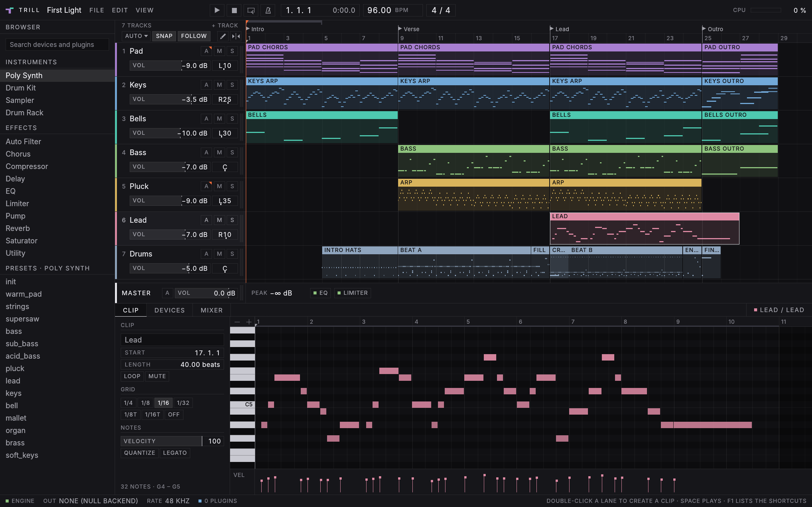

# Trill

Trill is an open-source digital audio workstation written in Rust. The goals:

- **It does not crash or stall.** The audio thread never allocates, locks or waits; plugins are scanned in a
  separate process; a device that panics produces a moment of silence instead of taking the app down. And when
  something does take it down, the work is not lost: a project with unsaved changes is copied to a safe place
  every twenty seconds and offered back the next time the program starts.
- **It hosts your plugins.** CLAP and VST3.
- **An AI can drive all of it.** Every operation is available over the
  [Model Context Protocol](https://modelcontextprotocol.io), so an assistant can compose, arrange, mix and render a
  song, and read back loudness and spectral measurements to judge its own work.



This is an early build. See [Status](#status) for what works and what does not yet.

## Quick start

```sh
cargo run -p trill-app                 # the application
cargo run -p trill-app -- --demo       # ...opening a demo song
cargo test --workspace               # the test suite
```

Development builds are optimized (see `[profile.dev]`), because unoptimized audio code cannot keep up in real time.

### Let an AI write a song

While the app is open it serves MCP on `http://127.0.0.1:7777/mcp` (`--mcp-port` changes the port, `--no-mcp` turns
it off), so you can watch and hear the edits happen and undo them like your own:

```sh
claude mcp add --transport http trill http://127.0.0.1:7777/mcp
```

Or run the DAW without a window, launched by the MCP client over stdio:

```sh
cargo build -p trill-mcp
claude mcp add trill -- /path/to/target/debug/trill-mcp
```

Then ask for music: *"Write a slow, warm synthwave track in A minor, about a minute long. Render it and check the
mix."* [`examples/first-light.trill`](examples/first-light.trill) was written this way, entirely through tool
calls.

## What is in the box

**Instruments**

| Device | |
|---|---|
| `builtin:polysynth` | 16-voice subtractive/FM synth: two oscillators, unison, sub, noise, multimode filter, two envelopes, LFO, mono/glide. 15 presets from pads and basses to FM keys and bells. |
| `builtin:drumkit` | Synthesized drum machine on the General MIDI map, with 808, 909, tight, trap and lo-fi kits. Each drum is shaped after measurements of recorded ones: where its energy sits and how long it rings. |
| `builtin:sampler` | Plays one audio file across the keyboard: loops with crossfade, reverse, one-shot, amp and filter envelopes. |
| `builtin:drumrack` | Sixteen pads on the General MIDI drum notes, each playing its own audio file, with level, pan, tune, decay and choke groups. |

**Effects**: `reverb`, `delay` (tempo-synced, ping-pong), `eq` (6-band), `compressor`, `limiter` (look-ahead
brickwall), `chorus`, `filter` (resonant, with LFO), `pump` (sidechain-style ducking locked to the grid),
`saturator`, `utility`.

**Plugins**: installed CLAP and VST3 plugins appear beside the built-in devices as `clap:<plugin id>` and
`vst3:<class id>`. Their state is saved in the project, and their parameters are automatable and reachable over
MCP like any other device's. A plugin's own editor opens in a window (Windows only so far), and what is changed
there flows back into the project.

**Songwriting**: chords by symbol or Roman numeral, voicings, rhythms, arpeggios, bass lines, drum grooves with
fills, melodies by scale degree, swing and humanizing, and reading a song's key and chords back from its notes
(`trill-theory`). Over MCP an assistant says `Am9 | Fmaj9 | Cmaj7 G/B | Em7`, drop-2, house groove, rather than
spelling notes.

**Sounds**: a library of the sample folders you point it at, scanned in the background and searchable by words,
tags, tempo, key and length (all read from file and folder names). Audio clips play WAV, AIFF, FLAC, MP3 and Ogg
Vorbis at any sample rate, and can be warped to follow the project tempo: `beats` keeps drum hits sharp, `tonal`
keeps sustained sound smooth, `repitch` plays faster or slower like a record; warped clips can be transposed.

**Engine**: sample-accurate MIDI and audio clips, clip looping, non-destructive trimming and splitting, audio
fades, automation of track and master volume, pan and any device parameter with straight, held or curved
segments, group tracks and return tracks with sends, a metronome, sample-exact transport looping, mute/solo, undo/redo, offline rendering that is bit-identical to
playback, and render analysis (peak, LUFS, stereo correlation, spectral balance, per-track levels).

**Application**: an arrangement with multi-clip editing (move and copy across tracks, trim either edge, split,
fades, a clipboard, time selection), markers, group and return tracks, and automation lanes that are edited by
hand or drawn in steps; a piano roll; device panels generated from each device's parameters; a mixer; MIDI import
and export; project files; WAV export. `F1` lists the keyboard shortcuts.

## MCP tools

| Area | Tools |
|---|---|
| Project | `get_project`, `set_project`, `new_project`, `save_project`, `load_project`, `recover_project`, `import_midi`, `export_midi`, `history` |
| Tracks | `create_track`, `update_track`, `delete_track` |
| Devices | `list_devices`, `describe_device`, `add_device`, `get_device`, `update_device`, `delete_device`, `show_device_editor` |
| Clips | `create_clip`, `create_audio_clip`, `update_clip`, `split_clip`, `duplicate_clip`, `delete_clip` |
| Sounds | `search_sounds`, `library`, `preview_sound`, `set_sample` |
| Notes | `get_notes`, `add_notes`, `set_notes`, `remove_notes`, `transform_notes` |
| Music | `write_chords`, `write_drums`, `write_arpeggio`, `write_bass`, `write_melody`, `analyze_music`, `music_reference` |
| Automation | `set_automation`, `get_automation`, `set_markers` |
| Arrangement | `edit_time` (remove, repeat or open up a stretch of time on every track at once) |
| Playback | `transport`, `render` |

Time is in beats. Pitches are MIDI numbers, note names (`"F#3"`) or drum names (`"kick"`). Notes can be written
compactly as `[pitch, start, length, velocity]`. Errors say what to do next: an unknown id comes back with the ids
that exist, a bad note with its index and the reason.

The HTTP server listens on localhost only and has no password: any program on the machine may use it. Pages in a
web browser may not; requests that carry a browser's `Origin` are refused.

## Architecture

```
crates/
  trill-core      Project model, edit operations, and the device API. No audio or UI dependencies.
  trill-dsp       Built-in instruments and effects, and offline time-stretching.
  trill-media     Audio file decoding and caching, waveform overviews, sample-rate conversion, WAV writing.
  trill-engine    Realtime engine, offline renderer, analysis, and the Session.
  trill-library   The sound library (scanning, indexing, searching sample folders) and the settings file.
  trill-plugins   Plugin hosting: scanning in a child process, the plugin main thread, CLAP and VST3.
  trill-runtime   What both programs share, built once: session, media cache, library, settings, housekeeping,
                  safety copies of unsaved work.
  trill-theory    Music theory for writing parts: chords, scales, voicings, rhythms, grooves, analysis.
  trill-mcp       MCP server (library) and the headless `trill-mcp` binary.
  trill-assistant Back end of the in-app assistant: runs the user's own Claude Code, confined to Trill's tools.
  trill-noir      The GUI kit: theme, widgets and painting.
  trill-app       The desktop application (`trill`).
```

Three ideas hold it together:

1. **One front door.** `Session` owns the project, its undo history and the engine. The GUI and the MCP server are
   both thin clients of it, so there is exactly one implementation of every edit and the two can never disagree.
2. **The audio thread only plays.** Edits happen off the audio thread. After each one the project is compiled into
   an immutable render graph and handed over through a lock-free queue; the audio thread swaps it in between
   blocks, carries running devices and sounding notes across, and sends the old graph back to be freed elsewhere.
3. **Everything is a device.** Built-in instruments, effects and hosted plugins implement one small trait
   (`DeviceProcessor`), so the engine does not know or care which it is driving.

The same `Processor` runs realtime playback and offline rendering. The tests rely on that: they render projects
and assert on the audio (note onsets to the sample, identical output for any buffer size, identical output while
the graph is swapped on every block). The GUI is tested headlessly with simulated input against a real session.

## Status

Working: everything listed above, with tests.

Not yet: running plugins out of process (only scanning is isolated today, so a plugin that crashes while playing
still takes the app with it; the safety copy is what saves the work), a button for plugin editors and a prompt
for recovered projects in the window (both are reachable over MCP so far), plugin editors on Linux and macOS, the
assistant's chat panel, session (clip-launching) view, audio recording, a sound browser and warp controls in the
window (the library, sample assignment and warping are reachable over MCP only so far), warp markers, MIDI input
devices, plugin delay compensation, multi-core rendering. Only Windows has been run so far.

## Licence

Trill is free software: you can redistribute it and modify it under the terms of the GNU General Public License,
version 3 or (at your option) any later version. It comes with no warranty. See [LICENSE](LICENSE).

The Inter typeface bundled in `crates/trill-noir/assets/fonts` is under the SIL Open Font License; its text is beside
the font.
