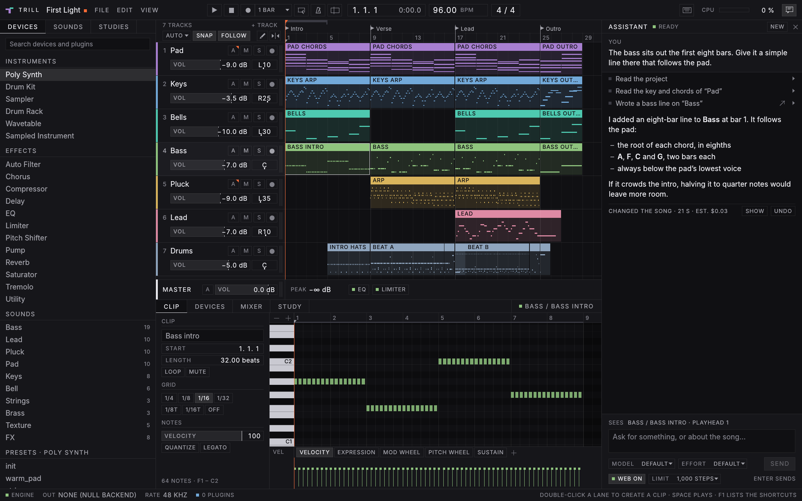

# Working with an AI

Everything Trill can do is a tool call over the [Model Context Protocol](https://modelcontextprotocol.io)
(MCP). An assistant outside the window connects as an MCP client; the assistant inside the window is a panel
that runs the Claude Code you have installed. Both use the same tools, listed at the end of this page.

## Connect an MCP client

While the app is open it serves MCP on `http://127.0.0.1:7777/mcp` (`--mcp-port` changes the port, `--no-mcp` turns
it off), so you can watch and hear the edits happen and undo them like your own:

```sh
claude mcp add --transport http trill http://127.0.0.1:7777/mcp
```

Or run the DAW without a window, launched by the MCP client over stdio:

```sh
cargo build -p trill-mcp
claude mcp add trill -- /path/to/target/debug/trill-mcp
```

Then ask for music: *"Write a slow, warm synthwave track in A minor, about a minute long. Render it and check the
mix."* [`examples/first-light.trill`](../examples/first-light.trill) was written this way, entirely through tool
calls.

## The assistant in the window

The assistant is a panel down the right side (`Ctrl+Shift+A`, or the button at the right end of the top bar). It
runs the Claude Code you have installed, signed in as you are there, against the same MCP server, and adds what a
client outside the window cannot have:

- every message goes with what you are looking at (the selected track, clips, notes and device, the time
  selection, the playhead, the loop, the open tab), so "make this busier" has a "this";
- everything it changes while answering one message is one undo step, with an Undo on the turn itself;
- when it has finished, what it made or edited is selected and brought into view (unless you are busy elsewhere in
  the window at that moment), and each tool call's line leads to what the call changed;
- the reply appears as it is written, set from its Markdown, and can be selected and copied like any text; each
  tool call is a line in plain words that unfolds to what was sent and answered, and Stop ends the turn;
- a big request, a whole song, runs to its end by itself: the assistant writes a plan, which stands above the
  message field as a checklist it ticks off, and the panel says how long it has run, which step it is on of how
  many one request may take, and what Claude Code estimates it has cost so far. It is still one undo step.

Under the message field: which model answers (Claude Code's own choice, one of the names it takes: `fable`, `opus`,
`sonnet`, `haiku`, or any name you type), how hard it thinks (Claude Code's own, or `low` to `max`), whether it may
use the web, and the most steps one request may take. The model and the effort are passed to Claude Code as they
are; what your account can use is for Claude Code to say.

With **Web** on, the assistant may search the web and read pages for what Trill does not know (a genre's
conventions, a technique), and every search and page is a line in the conversation with its query or address. Off,
it is given no way to reach the web. It never has a tool that reads or writes your files or runs a program: a page
it reads can at worst talk it into changing the song (one Undo) or writing a project, render or MIDI file into the
folders named below. Why the line is drawn there is in
[`crates/trill-assistant/src/lib.rs`](../crates/trill-assistant/src/lib.rs).

Trill never asks for, reads or stores a login: if Claude Code is not installed or not signed in, the panel says so
and what to do about it in a terminal. Conversations are kept per project beside the settings and taken up again
the next time the project is open. The assistant comes in by a door of its own on the MCP server (`/assistant`),
through which files are written only into the project's folder or `Documents/Trill`.



## MCP tools

| Area | Tools |
|---|---|
| Project | `get_project`, `set_project`, `new_project`, `save_project`, `load_project`, `recover_project`, `import_midi`, `export_midi`, `history` |
| Tempo and meter along the song | `set_tempo` (the tempo from a bar on: a jump, or with `ramp` a glide that arrives there), `set_time_signature` (the time signature from a bar on, for so many bars if asked), `get_tempo_map` (both, with the bar, the beat and the second of every change, the bars a change cuts short, and the beat any bar starts at) |
| How it was made | `get_journal` (the steps of the session, who made each and where it landed, a page at a time; found by their words), `get_song_at` (the song as it was after any step), `journal` (keep one or not, write it out to hand on, delete it) |
| Tracks | `create_track`, `update_track`, `delete_track` |
| Devices | `list_devices`, `describe_device`, `add_device`, `get_device`, `update_device`, `delete_device`, `show_device_editor` |
| Presets | `search_presets` (one search across the presets of every installed instrument and the saved ones), `save_preset` (keeps a device's sound under a name), `save_sound` (keeps a track's instrument and the effects after it as one sound, which is then a preset of the instrument), `edit_preset` (renames what was saved, or changes its description and tags), `delete_preset` (for good; the in-app assistant is refused it) |
| Clips | `create_clip`, `create_audio_clip`, `update_clip`, `split_clip`, `duplicate_clip`, `delete_clip` |
| Sounds | `search_sounds` (sounds, or with `kind: "instrument"` the sampled instruments, each with what it is), `library` (its folders, and `move_folder` for one that went elsewhere), `preview_sound`, `set_sample` |
| Studying | `study` (takes a recording apart with models on this machine and keeps it: start with a file, a clip or, for a client of the user's own, a link; report with the stage it is at; stop; take up again; list; delete and drop its stems, each after saying which songs play them; gather what the open song plays of studies beside it), `take_from_study` (a stretch of its stems or one of its loops as audio that follows the song's tempo and, where asked, its key; a sung line or word as that stretch of the vocal; a single hit onto a lane, a pad or a sampler; a kit as a drum rack; a part as notes on an instrument track, a groove by the kit's own drum names; its parts as markers; its tempo bar by bar; its key; the recording as a reference track), `setup` (every part there is to fetch with its size, licence and source, which are here, fetch, stop and remove one; a list as long as the catalogue of instruments is counted, and read a page at a time when it is asked for by name; what runs the models and the test that times it, the programs that were found; the assistant in the window reads it and fetches nothing) |
| Instruments to be had | `instrument_catalogue` (the sampled instruments others publish that may be used and handed on: counted by kind and licence, searched by words or kind, or one set with its licence as its maker wrote it; says which are in the library already, and how a set is fetched with `setup` when the user asks for it; fetches nothing itself), `song_credits` (what the open song owes the makers of the sampled instruments it plays: the lines to put where it is released) |
| Listening | `listen` (what is in an audio file of the library, of the user's or of a clip, or what a `study` found in a recording's stems, with the words line by line and each word's bar and beat, or of one `stem` of it: tempo and bars, key, tuning, and on request its chords, parts, loops, single hits, groove, bass and melody in the recording's own bars, paged; corrections to its beat grid), `transcribe` (its bass line, melody, groove or chords as MIDI on its own beats: into a file, or into the song on a new track in one undo step) |
| Wavetables | `describe_wavetable` (the tables of `builtin:wavetable` that ship, any of them or a recipe of your own shown frame by frame in numbers; changes nothing), `set_wavetable` (gives an oscillator a table that ships, one made from a recipe, or one read from an audio file; names the macros) |
| Missing files | `missing_files` (what the song names that is not on disk, where it is used, and what was found with how sure it is), `relink_files` (what is sure, or more on request, or a folder or files named by hand: one undo step) |
| Notes | `get_notes`, `add_notes`, `set_notes`, `remove_notes`, `transform_notes` |
| Controllers | `get_controllers`, `set_controllers`, `shape_dynamics` (gives a line its dynamics from its notes, as an expression curve) |
| Music | `write_chords`, `write_drums`, `write_arpeggio`, `write_bass`, `write_melody`, `analyze_music`, `music_reference` |
| Instruments | `get_instrument_profile`, `set_instrument_profile` (what a track's notes mean to its instrument: drums or pitches, the drum map, keyswitches, range, octave, bend range; kept in the song and remembered for the plugin) |
| Automation | `set_automation`, `get_automation`, `set_markers` |
| Arrangement | `edit_time` (remove, repeat or open up a stretch of time on every track at once; copy one to another place, on every track or some, over what is there or making room) |
| Playback | `transport` (play, stop, seek, record; says when the song is more than the machine plays in time), `playback_load` (how the machine keeps up with the song as it plays live: the share of the audio thread's time in use, the buffers that came late, the threads it is made on, and what each track costs; nothing to do with a render) |
| Film | `film_plan` (what a film would be, take by take, before any of it is made; costs nothing), `film` (makes it: the song or a stretch of it with its own sound, or how it was made, as an .mp4) |
| Hearing | `probe` (what an instrument does: range, octave, keyswitches, drum map), `measure` (the mix, every track, every section, gain reduction; writes nothing), `render` (the same, and a WAV file; with `stems`, every track, group and return in files of their own from the same pass) |
| Playing live | `play_notes`, `midi_inputs`, `audio` (device, sample rate, buffer size, latency) |

Time is in beats. Pitches are MIDI numbers, note names (`"F#3"`) or drum names (`"kick"`). Notes can be written
compactly as `[pitch, start, length, velocity]`. `set_automation` takes a track's volume or pan, the master's
volume, a device's parameter or a send (`{"type": "send", "track": 3, "to": 9}`), says in its description how a
line travels for each, and answers with what the envelope's lines are straight along. `get_automation` lists a
thousand points a reply and reads on by target, by a stretch of beats or by offset: a song may hold tens of
thousands. Errors say what to do next: an unknown id comes back with the ids
that exist, a bad note with its index and the reason.

Presets are part of the device tools, for plugins as for built-in devices: `describe_device` and `get_device` list
them a page at a time and search them (`preset_query: "warm pad"`, `preset_category: "Pads"`), and `create_track`,
`add_device` and `update_device` take one by its name, its category and name, or its id. `search_presets` looks
for a sound ("warm pad", "808 sub") across every installed instrument at once and answers with the device and the
preset to give `create_track`; the presets are read in the background the first time and remembered, and the reply
says which are still being read. `list_devices` says how many presets a plugin has, where that is known. The
presets a maker keeps in files of its own format (see [the makers' own presets](plugins-and-presets.md)) are among them, and `preset`
also takes the whole path of a preset file that lies anywhere (`search_presets` finds those of the sample library:
an item with `file`). After a preset
that sets the plugin reading samples, the reply has a `note` that says so. A plugin that lists none says so in a
sentence: its presets are in its own window, and `save_preset` keeps what is chosen there.

`get_device` is small whatever the device: for a plugin with hundreds of parameters it gives the count and the
ones that are not at the plugin's own defaults, `query` finds others by name with their ranges and choices, and
`show: "all"` pages through every one. It says which track a compressor listens to (`sidechain`), which
`add_device` and `update_device` set. Each of a plugin's parameters comes with `text`, the value as the plugin
displays it, and `update_device` takes that text as well as a number: `{"Cab L Mic Type": "Dynamic 57", "Input
Gain": "-6 dB"}`. It also says which channels the device takes and gives. Where a plugin's saved state has
settings that no parameter reaches, `get_device` counts them (`settings_count`), `query` finds them by name beside
the parameters, and `update_device` sets them: `"settings": {"M-Fret Sound": 1}`.

`load_project` answers with the whole song at once, and the song's plugins are made after it, one at a time
([the engine](engine.md) has how long that takes). Until all are there the reply and `get_project` carry a
`loading` note that says how far they are ("12 of 38 devices: Archetype Tim Henson X on Lead") and which are
not made yet, and each such device is marked `not_made_yet`. The song can be read and edited meanwhile; what is
asked of a device that is not there (a parameter, a preset, its window) is refused in a sentence that says to
ask again, `transport` says so when play is pressed, and `probe`, `measure` and `render` make their own devices
and wait for them as always. The note is gone when every device is there.

Every call is entered in the session's journal as it is made, under what it did in words and by the name the
client gave: `get_journal` lists them, `search: "chorus"` finds the step where the chorus was written, `after`
lists what changed since, and `get_song_at` shows the song as it was there. Undoing takes nothing out: a step
that was undone is followed by one that takes it back.

`film` takes minutes, so `film_plan` comes first: it lists the takes the director would shoot, each with its
bars, its shot (`wide`, `close`, `ensemble`, `song`), the parts shown as piano rolls and whether it is cut or
moved to. `direct` changes them, a stretch at a time: `{"section": "Chorus 2", "shot": "close", "parts": [7]}`
holds the lead close for that chorus, `{"from_bar": 17, "to_bar": 24, "shot": "wide", "enter": "cut"}` cuts wide
at bar 17. What is left out stays the director's, and the plan read again shows what was got. `size` is
`"1080p"`, `"2160p"` or `"upright"`; `section` or `start`/`end` film a stretch; `of: "making_of"` films the
journal instead. The assistant in the window writes films only into its working folders, as it writes
everything else.

The HTTP server listens on localhost only and has no password: any program on the machine may use it. Pages in a
web browser may not; requests that carry a browser's `Origin` are refused.
