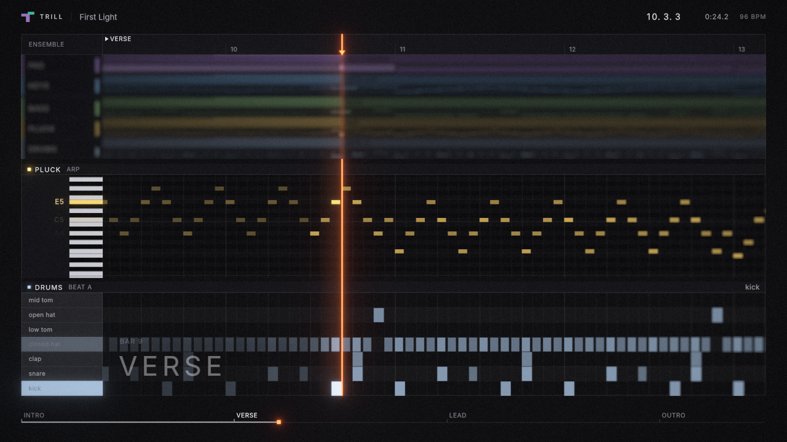

# The making-of, the stage and films

## Watch how a song was made

Trill keeps a journal of the session: every change to the song is a step in it, with who made it (you at the
window, the assistant, or a program working through MCP), when, what it was in words and where in the song it
landed; between the steps, what you and the assistant said, its plan, and what it measured. **Making of**
(`Ctrl+Shift+M`, or the View menu) plays the session again from it: the arrangement and the piano roll show the
song as it was, clips arriving and notes filling in in the order they sound, the view going where each step
landed; the conversation as it came stands down the right; and the whole session is a line along the bottom to
play, hold, step through (`Left`, `Right`) and scrub, at half speed up to eight times.

- The waiting is cut out. A step is given the time it takes to watch and a long wait is a beat, so an hour of
  work plays in a few minutes, or in one at a higher speed.
- Nothing there can change the song: what is watched is a copy, and leaving (`Esc`) puts the window back as it
  was.
- Undo takes nothing out of the story. A step that was undone is followed by one that takes it back, and a redo
  by one that brings it back.
- **The journal never travels with the song.** It has your conversation in it, so it is kept in Trill's own
  folder (`journals`, beside the settings), written when the song is saved, and never in the project file or
  beside it: sending someone a `.trill` file sends the song. To hand the story on, *File, Making of, Export*
  writes it to a `.trillstory` file, without the conversation unless you choose the item that says with it; the
  other side watches it with *Watch one from a file*.
- It costs little: a step holds what it changed, and a plugin's state (megabytes) is held once however many
  steps it lasts through. A hundred steps on a song with a megabyte of state add about 30 KB. Past 20,000
  entries or 32 MB of story the oldest entries are let go, and the story begins with the song as it was after
  them. Journals are kept for the two hundred songs most recently saved.
- *View, Keep a journal* switches it off; *Delete this song's journal* deletes one.

## The stage, and a film of the song

**The stage** (`F11`, the button beside the metronome, or the View menu) is the song filmed as it plays: Trill's
own lanes, clips and piano rolls on the whole screen, lit by what sounds, with a director choosing the shots.
Nothing on it is made up for the camera. It is the song's interface, staged.

- **A director that reads the song.** Wide on the fullest sections, close on the piano roll of a part that
  carries the tune, the lanes over the rolls of whoever drives a section otherwise; a cut where the song jumps
  and a move where it does not. The shots are a function of the song alone, so the same song is the same film.
- **Two things light it, and they are kept apart.** What is *written* lands exactly: a note lights on its beat
  and a kick is a flash, to the frame. What is *heard* sets the mood: how loud the mix is, and each part by its
  own level.
- **Recordings and automation are on it too.** An audio clip, or the sample a track plays, is its waveform, lit
  where the playhead has just been; an automated parameter is its line.
- **A tempo or a time signature that changes is part of the picture.** The stage follows the song through every
  change of either, so a note still lights on the frame it sounds on and a film is as long as its sound. The
  ruler says what arrives beside the bar it arrives at ("7/8 · 140 BPM", an arrow before a tempo the song
  glides to), the place at the top right reads in the bars and the tempo the song has there and lights as they
  change, and the arrival is titled as a section is.
- It is drawn by passes of its own on the graphics card (light that spreads, depth of focus, and in a film the
  blur of motion), and the window's own drawing is untouched: with the stage shut, none of it runs.
- `Space` plays and stops. `Esc` or `F11` leaves, and the window is as it was, its size included.

**File, Export a film** (`Ctrl+Shift+F`) makes an `.mp4` of it. The panel asks what the song does not say:

- *what of*: the song, or how it was made (below);
- *size and rate*: 1920×1080, 3840×2160, or 1080×1920 upright for a phone, at 60, 30 or 24 frames a second;
- *which stretch*: all of it, the time selected in the arrangement, or a section by its marker.

The film renders **the song's own sound** in the same job, as *Export WAV* would: plugins are waited for, and
each part is lit by its own level in that render. Frame 600 of a film at sixty a second is the stage at ten
seconds however long it took to draw, so nothing depends on how busy the machine is. *Fine* exposes every frame
from eight moments and draws it at twice its size; *Plain* is one moment, as the window shows it, and about
twice as fast. The film is made away from the window, which goes on being worked in: the panel and the status
bar say how far it is, and *Stop the film* ends it and keeps nothing. Frames are handed to
[ffmpeg](https://ffmpeg.org), a program found on the `PATH` when a film is made and not a part of Trill;
without it the film is numbered pictures in a folder with its sound beside them, and the panel says so before
any work is done. A film needs a graphics card.

**A film of how the song was made** (*How it was made* in that panel, or *Film…* in the making-of's bar) stages
the journal. The camera goes where each step landed: close on a part while it is being written, wide between.
Notes arrive lit. What you asked and what the assistant answered are cards over the song, as in a silent film;
its plan ticks off; and the film ends on the finished song. The story's time is the film's, told as much faster
as it takes to be no longer than the song, because **the finished song plays under it**, timed so that the film
ends as the song does. (What was being made could not be heard while it was made: half of it was not there yet.
The song it became is the one sound that is true of all of it.) The film is made from the journal and has your
conversation in it, so it goes where you say and nowhere else.

An assistant films too, and directs: see `film_plan` and `film` under [MCP tools](ai-and-mcp.md#mcp-tools). Without the
window, a song that plays through the built-in devices is filmed by
`cargo run -p trill-stage --example film -- SONG.trill --film OUT.mp4`.
