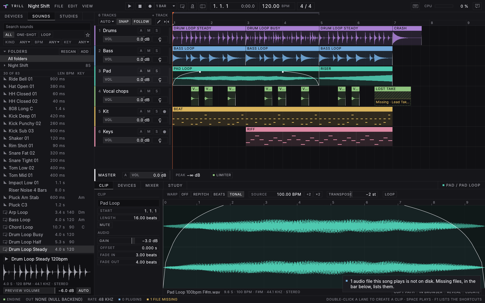
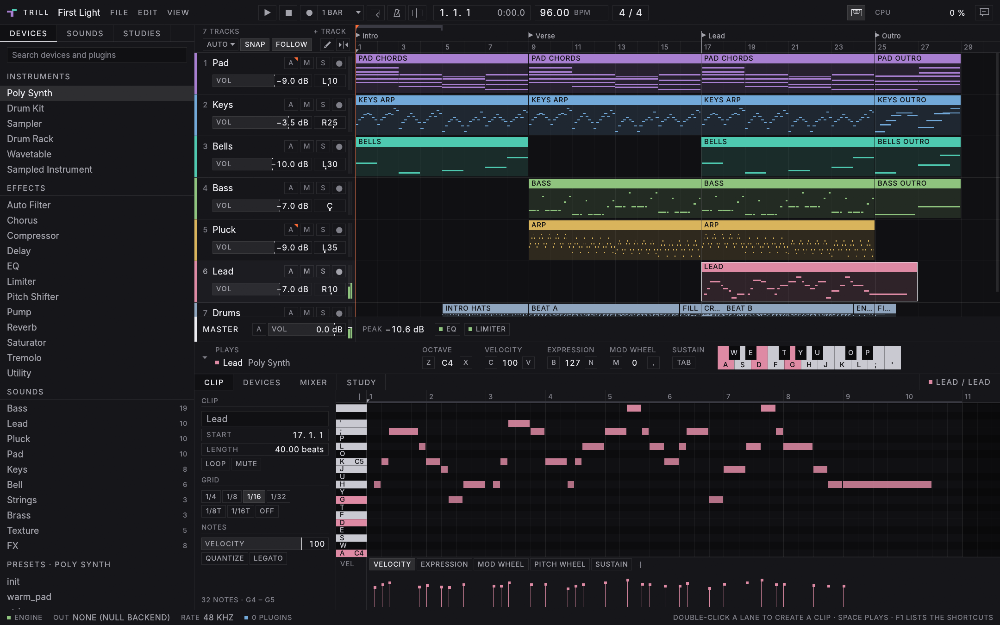

# The window

## Editing

**Application**: an arrangement with multi-clip editing (move and copy across tracks, trim either edge, split,
fades, a clipboard, time selection, deleting, repeating or inserting a stretch of time on every track at once,
and copying one, with its automation, to paste over what is there or with room made for it), markers, group and
return tracks, and automation lanes that are edited by hand or drawn in steps; a piano roll, which lists a drum
track's rows by the names its kit has for them; device panels generated from each device's parameters; a mixer; MIDI import and export; project files; WAV
export, with every track, group and return as files of their own if wanted. `F1` lists the keyboard shortcuts.

The lane under the piano roll's notes shows velocity or a MIDI controller of the clip, chosen from the chips
above it: expression, the mod wheel, the pitch wheel, the sustain pedal, whatever else the clip holds, and any
other from the `+` beside them. A dot on a chip says the clip has a curve for that controller. The curve is
edited as an automation lane is: a click adds a point, points and lines drag, `Alt`-drag bends a line, a
double-click or `Delete` removes, a drag over nothing selects, and the pencil writes steps on the grid; each
gesture is one undo step. While a take is recorded its clip is in the piano roll, and the lane shows the wheel or
the pedal going down as it is moved. A track whose instrument is given notes and stays silent for a second is
marked on its header and in the lane's strip, with what to do about it (`--lane expression` opens the window with
the lane on a controller).

An automated control is not locked: drag it and it is yours. Its envelope is switched off, not lost, the mark in
the control's corner turns into an outline, and a click on that mark (or on the switch of its lane) hands the
control back to the envelope. That holds for a volume, a pan, a device's parameter and a send alike: a send's bar
in a track's header and in the mixer shows where its envelope has it, and a track's lanes offer its send to each
return beside its volume and pan. A lane of thousands of points (a compressor worked out elsewhere and drawn in)
is painted by its width: where points crowd, the line alone is drawn, and their squares come back as the view is
zoomed in. And when the program did not live to save a project, the window that opens next
offers it back: recover it, discard it, or decide later (`File`, `Recover unsaved work`).

The browser's **Sounds** tab is the sample library: add folders, search as you type, filter by one-shot or loop,
kind, tempo and key, mark favorites, and hear a sound as you select it. Drag a sound onto a track for an audio
clip where it lands (loops whose name states a tempo follow the song's), below the tracks for a new track, onto a
sampler or onto a drum rack pad; files dragged in from the file manager land the same way. Audio clips show their
waveform, and the Clip tab shows an audio clip's file with its gain, offset, fades, warp mode, source tempo and
transposition. The sampler shows its sample and the drum rack its sixteen pads.

## Playing and recording

**Playing and recording**: every MIDI keyboard that is plugged in plays the armed tracks (or the selected one)
without a visit to the settings: notes, velocity, pitch wheel, mod wheel and sustain pedal, for built-in
instruments and plugins alike. A key is placed in its audio buffer by the time it went down, so it is heard a
fixed moment later rather than whenever the next buffer happens to start. Recording writes what is played into
clips where it was *heard*: the engine takes the output latency off again, to the sample. The wheels, the pedals
and expression are recorded with the notes, thinned to the few points of a curve that follows the hand. A
count-in, loop recording that layers each pass onto the last, one undo step per take. See
[Playing and latency](#playing-and-latency).

**Arm a track and record.** A track with an instrument has an arm button in its header and on its mixer strip,
lit while it is armed. The armed tracks are what every keyboard plays and what a take records; arming one disarms
the rest, and `Ctrl`-click keeps them. `F9`, or the record button in the transport, starts a take after the
count-in chosen in the box beside it (none, one, two or four bars). The transport says what the take is doing
(counting in, recording, and which pass of the loop when the loop is on); `Space` or Stop ends it, what it wrote is
selected, and one undo takes the whole take back. Asked to record with nothing armed, Trill arms the selected track
if it has an instrument, and otherwise says why it cannot.

## Audio and MIDI settings

**Audio and MIDI settings** are one panel: `Ctrl+,`, `File`, or a click on the device in the status bar. It has
the output device, exclusive mode, the sample rate and the buffer size, and beside the choice what is running now
with its latency in milliseconds as the device reports it. What a choice costs is said before it is applied:
exclusive mode silences other programs on that device, and another sample rate stops playback and closes plugin
windows. Devices are listed and opened away from the window's own thread, so a driver that takes its time shows
as "Opening the device…" in a window that still draws. A device that was unplugged, a list that comes back
empty, a choice that fell back to something else: each is a sentence in the panel, with what Trill does about it.
Below are the MIDI inputs, each with a switch, a lamp that lights when it sends, what is wrong with it if
anything is, and a rescan. The status bar shows the device, rate, buffer and latency as they are at the moment.

## Playback load

**CPU in the top bar** is the share of each buffer's time that making it takes. A click on it opens what is
behind the number: how the audio thread kept up over the last ten seconds (on average and for its worst buffer),
how many buffers came late, on how many threads the song is made, the buffer the device asks for, and every
track with the share of one processor it takes, the costliest first. A track costs what it costs whether or not
it is muted or anything plays on it, because its devices run all the time; switching a device off or removing it
is what takes its cost away, and the panel says so.

**A song that is more than the machine plays in time is said so, once.** A buffer that takes longer to make than
it lasts is a gap in what is heard. When five or more come late within ten seconds, a notice says that the song
is more than this machine plays in time and that an export is not affected. It is one notice, not one a buffer:
the next comes only when the song has kept up for a minute in between. For as long as it holds (and ten seconds
after the last late buffer) the status bar has a line with the count, the CPU readout is in the signal colour,
and the panel begins with the whole sentence: how many buffers came late, which tracks cost most, and what
helps. One or two late buffers in a while are not that: every song has a plugin take its time over a block now
and then.

The same figures and the same sentence are what a model gets from `playback_load` and `transport`. A picture of
the window shows no load of its own; `--load calm` and `--load short` open the panel on a made-up one.

## Playing from the computer keyboard

**Play it from the keyboard you type on.** `Ctrl+K`, or the keyboard button in the top bar, turns the two middle
rows of letters into a piano that plays where a MIDI keyboard plays (the armed tracks, or the selected one) and
is recorded like one: `A S D F G H J K L ; '` are the white keys from C
and `W E T Y U O P` the black ones, `Z` and `X` move them an octave down and up, `C` and `V` play softer and
louder, `B` and `N` give less and more expression, `M` and `,` turn the mod wheel down and up, and `Tab`
sustains while it is held. The keys are where they are on the keyboard, whatever layout types
on them. A strip above the detail panel shows the octave, the velocity, expression, the mod wheel, the keys with
the letter on each and the notes being held, and says why nothing sounds when nothing can (no track selected, a
track with no instrument, a muted one, an instrument that is given the notes and puts nothing out); the piano
roll's own keyboard lights the same notes. The switch, the octave and the velocity are remembered.

A track is told the keyboard's expression (full, until it is set lower) and where its mod wheel is just before
the first note typed on it, and whenever either changes after that: an instrument that waits for breath sounds
when it is simply typed on, and a take records what it was played with. When the keys stop playing a track, its
mod wheel is put back at rest and its expression back at full.

While it is on, a letter it uses plays a note, and the shortcut that letter had is `Alt` with the letter (`F1`
lists them as they are at the moment). It never takes a key while a text field, the sound search or a dialog has
the keyboard, or while `Ctrl`, `Alt`, `Shift` or the Windows key is held. And no note is left sounding: whatever
ends the playing (the switch, another track selected or armed, an octave change under a held key, the window
losing the keyboard, a dialog, another audio device, another project, exit) ends its notes, and gives back the
controllers the keyboard moved.

No samples at hand? `cargo run -p trill-app --example sound_fixtures -- some/folder` synthesizes a small pack and a
song made from it (it is what the screenshots are taken from); add `some/folder/Night Shift` in the browser, or
start with `--library "some/folder/Night Shift" --browse sounds some/folder/night-shift.trill`.

## Playing and latency

The audio device, its sample rate and its buffer size are chosen while the program runs and remembered; the
project, its undo history and the playhead are untouched by a change. If the device is not there the next time,
or refuses the format, or is unplugged while a song plays, Trill opens the nearest thing (down to no device at
all), says what it did and why, and takes the device up again when it is back. A driver that never answers
costs a few seconds' wait, not the program.

How short the delay between a key and its sound can be depends on how the device is opened:

- **Shared** (the default): the device also plays every other program, through the system's mixer. On Windows
  that mixer works in periods of 10 ms and keeps a few of them queued, so the delay is around 30 ms whatever
  buffer size is asked for.
- **Exclusive** (Windows; `exclusive` in the audio settings): Trill takes the device for itself and plays it
  directly, at the buffer size asked for, down to about 3 ms on ordinary hardware. No other program can use the
  device meanwhile. This is WASAPI's exclusive mode and needs nothing installed.
- **ASIO** is not built. The audio library Trill uses supports it, but only with Steinberg's ASIO SDK present
  at build time (downloaded under Steinberg's licence, with LLVM for the bindings), which is too much to ask of
  everyone who builds Trill. It would be an optional cargo feature, off by default, plus a fourth audio host in
  `trill-engine/src/host`.

On macOS and Linux the system's own audio (CoreAudio, ALSA) honours the buffer size without any of this; neither
has been run yet.
